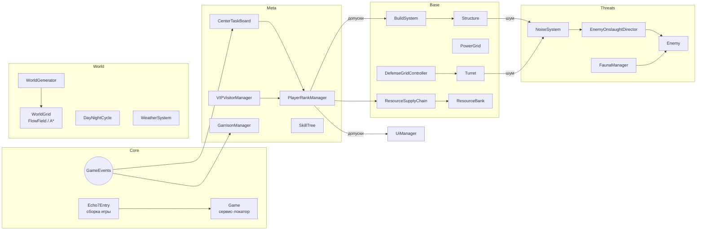

# Архитектура «Эхо-7» и ответы на §7 GDD

Документ отвечает на пять пунктов технического задания из GDD. Ссылки ведут на реальный код в `Assets/Echo7/Scripts`.

## 1. Анализ GDD

Ядро игры — напряжение между **ростом** и **заметностью**. Каждое полезное действие (стройка, добыча,
стрельба, взрывы) делает аванпост громче, а громкость вызывает волны. Вторая ось — **зависимость от Центра**:
базовые ресурсы приходят сверху, а их объём зависит от репутации. Репутацию двигают KPI и решения по высоким чинам.
Третья ось — **планета**: погодный цикл меняет экономику (вода, солнце, износ) и сам ландшафт.

Поэтому в архитектуре три «связующих» системы, через которые проходит почти всё:

- `NoiseSystem` — единая метрика заметности;
- `PlayerRankManager` (ранг и репутация) — единая точка допуска к контенту;
- `GameEvents` — шина событий, через которую KPI, мораль и UI узнают о происходящем, не зная друг о друге.

Самые рискованные места GDD:
- Многоуровневые базы. Сетка двухъярусная: земля и второй ярус на высоте стены (п. 8). Враги ходят по земле, поле потока осталось плоским.
- Свободная камера от третьего лица против вида как в Diablo 4. Выбран изометрический вид D4, как и указано в GDD.
- Объём контента. Все цифры баланса собраны в таблицы-каталоги.

## 2. Архитектура кода



### Ключевые классы

**`PlayerRankManager`** ([Progression/PlayerRankManager.cs](../Assets/Echo7/Scripts/Progression/PlayerRankManager.cs))
- Хранит ранг, очки ранга (ОР) и репутацию в Центре (0–100).
- `AddPoints()` повышает в звании и даёт очки навыков. `Demote()` — трибунал.
- `IsUnlocked(Feature)`, `RequiredRank(Feature)`, `LockReason(Feature)` — единый API допусков (см. п. 4).
- Ранг масштабирует и мир: радиус застройки (`BuildRadius`), число строительных дронов, бюджет волн.

**`ResourceSupplyChain`** ([Economy/ResourceSupplyChain.cs](../Assets/Echo7/Scripts/Economy/ResourceSupplyChain.cs))
- Плановая поставка каждое утро (`PlannedDelivery()`). Объём зависит от репутации, недавних KPI, ранга и профиля поставок.
- При репутации ниже 35 поставка задерживается; `SkipNext` пропускает поставку (наказание за отказ высокому чину).
- Капитан выбирает профиль поставок: боеприпасы, стройка или провизия (право голоса).
- Орбитальная доставка тяжёлых модулей: `Catalog()`, `CanOrder()`, `Order()`. Требует посадочной площадки и тратит репутацию и кредиты.
- Здесь же почасовой расход пайков и воды гарнизоном. Удовлетворённость передаётся в `GarrisonManager`, оттуда — в мораль.
- Груз приходит физической капсулой `DropPod` с шумом при посадке.

**`DefenseGridController`** ([Defense/DefenseGridController.cs](../Assets/Echo7/Scripts/Defense/DefenseGridController.cs))
- `PickTarget(turret)` — выбор цели без физических запросов:
  - лазеры и тяжёлые орудия предпочитают бронированных (танков);
  - пулемёты — лёгких;
  - приоритет у тех, кто грызёт постройки;
  - штраф за «перегруз», то есть за цели, которые уже ведут другие турели.
- `SensorBonus()` — +15% дальности рядом с сенсорной мачтой. `HasSensors` даёт раннее предупреждение о волне.
- `AssignCrew()`, `ClearCrew()`, `OnCrewDied()` — расчёты из гарнизона и переход турели в автономный режим.
- `Alert` — тревога, когда враги в периметре. Она влияет на поведение NPC и дронов.
- Сама турель — [Defense/Turret.cs](../Assets/Echo7/Scripts/Defense/Turret.cs): профили, хитскан, луч, баллистика, износ.

**`EnemyOnslaughtDirector`** ([Enemies/EnemyOnslaughtDirector.cs](../Assets/Echo7/Scripts/Enemies/EnemyOnslaughtDirector.cs))
- Планирует и выпускает волны. Подробно — в п. 3.

**`VIPVisitorManager`** ([Narrative/VIPVisitorManager.cs](../Assets/Echo7/Scripts/Narrative/VIPVisitorManager.cs))
- Расписание визитов (с 3-го дня, раз в 3–5 дней). Челнок `Shuttle` садится на площадку, NPC `VipNpc` идёт к командному модулю.
- `VipVisit` — запросы (`VipRequest`: лучшее, хлам или отказ). Медик и охрана уходят с чином физически (`GarrisonNpc.SendAway`).
- Качество поддержки `Quality` (0–1) задаёт шанс успеха миссии. Исход приходит через сутки:
  - успех — репутация, ОР, уникальные награды (чертёж щита, закрытый рынок, грант);
  - гибель чина при плохом обеспечении — `Demote()` (трибунал);
  - отказ — минус репутация и пропуск поставки.

**Остальные системы:**
- `NoiseSystem`, `EnemyManager`, `FaunaManager` — угрозы.
- `BuildSystem`, `Structure` и наследники, `PowerGrid`, `ConstructionManager` — база.
- `CenterTaskBoard` — KPI Центра (обучение и генератор задач).
- `TutorialDirector` — пролог и постепенное раскрытие механик (см. п. 6).
- `GarrisonManager` и `GarrisonNpc` — мораль, посты, болезни, дезертирство.
- `WeatherSystem` — пекло, буря, ливни, насекомые, «зелёность» и уровень воды.
- `GlobalMap` — рудник, станция, экспедиции.
- `DialogueSystem` — узлы, выборы и условия.
- `SaveSystem` — JSON.

### Принципы
- **Сервис-локатор `Game`** вместо DI-контейнера: для прототипа это прозрачнее. Статика сбрасывается
  в `SubsystemRegistration`, поэтому можно отключать перезагрузку домена в Enter Play Mode.
- **Шина `GameEvents`.** Задачи Центра подписываются на «постройка завершена», «добыт ресурс», «волна отражена»
  и не знают о системах-источниках.
- **Баланс в ScriptableObject** ([docs/BALANCE.md](BALANCE.md)). Каталоги (`BuildingCatalog`, `TurretProfile`,
  `EnemyArchetype`, `SkillTree`) строят описания из значений в коде и накладывают на них записи ассетов из
  `Resources/Echo7Balance`; задачи Центра и визиты читаются из ассетов напрямую. Без ассетов игра работает на значениях из кода.
  В ассетах только «сила» (цифры, тексты, условия). «Механика» — модели, режимы огня, как засчитываются задачи — остаётся в коде.
- **Визуал отделён от логики.** Модели собираются в `StructureModels`, `CreatureRig` и `HumanoidRig`;
  логика ищет только узлы с именами `#head`, `#door` и т.п. Замена на префабы не трогает геймплей.

## 3. Механика «Неожиданная волна»

### Источники шума
Каждая система вызывает `Game.Noise.Emit(позиция, сила, источник)`:

| Источник | Шум |
|---|---|
| выстрел игрока | 0.8 |
| граната | ~6–15 |
| пулемётная очередь | 0.35 за выстрел |
| тяжёлое орудие | 4 |
| установка постройки | 4 |
| работа дрона-строителя | 1.2/с |
| бур | 0.7/с |
| ручная добыча | 1.6 |
| посадка капсулы | 10 |
| подрыв пещеры | **70** |

Навык «Скрытность» снижает шум от действий игрока.

`NoiseSystem` ([Enemies/EnemyManager.cs](../Assets/Echo7/Scripts/Enemies/EnemyManager.cs)) хранит:
- `Level` — суммарный уровень, который экспоненциально затухает (полураспад `GameConfig.noiseHalfLife`);
- журнал недавних событий с координатами: `DominantDirection()` возвращает направление от базы на «центр тяжести» шума,
  взвешенный по силе и свежести.

### Директор (упрощённый псевдокод реального `Update`)

```csharp
// каждый кадр
pressure += dt * (noise.Level * 0.035f + baseline(day, night) * clamp01(timeSinceLastWave / 180));

// 1. всплеск: взрыв у пещеры, канонада — быстрая реакция
if (noise.Level > SpikeLevel && cooldown(150s) && noIncoming)
    Schedule(NoiseSpike, budget: BaseBudget() * clamp(noise.Level / SpikeLevel, 1, 2.2) * 0.8, delay: 20s);

// 2. накопленное давление — «неожиданная волна»
if (pressure >= Threshold && timeSinceLastWave > 120s && noIncoming)
{
    var trigger = noise.Level > 8 ? Noise : Random;   // шумели — придут на шум
    Schedule(trigger, BaseBudget() * (trigger == Noise ? 1.0 : 0.7), delay: 18s);
    pressure = 0;
}

// 3. ночь — гарантированная волна через 2 игровых часа после заката (бюджет растёт от шума)
OnNightStarted: Schedule(Night, BaseBudget() * 1.2 * (1 + clamp(noise.Level / 60, 0, 1.5)), delay: 2h);

BaseBudget() = (5 + day * 3.5 + rank * 6) * difficulty;
```

### Состав волны (`Compose`)
Бюджет «тратится» на архетипы с ценой `Cost`. Доступность зависит от дня и ранга: прыгуны с 2-го дня,
громилы с 3-го, плевуны с 4-го, танк с ранга Капитан и 5-го дня. Веса подстраиваются под базу игрока:
- много мелких построек и узлов → больше грызунов;
- много механизмов и ограждений → больше прыгунов;
- число танков ограничено: 1 + день / 10.

Мелочь выходит первой, танк — последним.

### Подача
- Предупреждение «Сейсмодатчики: … с направления «северо-восток», ~N особей».
  С сенсорной мачтой виден полный состав, а подготовка длится в 1,6 раза дольше.
- Спавн группами по 2–5 на краю карты в направлении шума, разброс ±18 м.
- Громилы и плевуны идут по **полю потока** к реактору. Стены для них не непроходимы, а «дороги» с ценой,
  пропорциональной прочности, поэтому волна сама находит слабое место.
- Особые юниты ведут себя по-своему ([Enemies/Enemy.cs](../Assets/Echo7/Scripts/Enemies/Enemy.cs)): грызуны ищут
  мелкие постройки и кабели, прыгуны — механизмы, танк идёт прямо на реактор.

## 4. Ранги, блокирующие UI строительства и глобальную карту

Единая модель: `enum Feature` → минимальный `Rank` (таблица `FeatureRanks` в `PlayerRankManager`).
Все потребители спрашивают одну функцию — `IsUnlocked(feature)`.

- **Меню строительства** ([Building/BuildSystem.cs](../Assets/Echo7/Scripts/Building/BuildSystem.cs), `LockReason(def)`).
  У каждой постройки в каталоге есть `RequiredFeature` или `MinRank`, а у уникальных — `RequiredFlag` (например, чертёж щита от генерала).
  Меню показывает недоступные пункты серыми с причиной («Требуется ранг: Лейтенант»), а `Begin()` не даёт начать стройку.
- **Окна интерфейса** ([UI/UiManager.cs](../Assets/Echo7/Scripts/UI/UiManager.cs)). `UiManager.RequiredFeature(UiWindow)`
  сопоставляет окну допуск: глобальная карта — `Feature.GlobalMap` (Майор), орбитальная доставка — `Feature.OrbitalDelivery` (Капитан).
  `Open()` проверяет допуск и при отказе пишет причину. Кнопки на панели рисуются «запертыми».
- **Глобальная карта** ([Narrative/GlobalMap.cs](../Assets/Echo7/Scripts/Narrative/GlobalMap.cs)). У каждого региона свой допуск
  (`SecondOutpost` для рудника — Капитан; станция и экспедиции — `GlobalMap` плюс построенный космопорт).
  `LockReason(region)` собирает все условия.
- **Диалоги.** Пункты связи с Центром используют `Unavailable = () => Rank.LockReason(Feature.CenterVoice)`,
  и тот же механизм показывает «запертые» варианты.
- **Реакция на смену ранга.** `GameEvents.RankChanged` срабатывает и при повышении, и при трибунале. Из-за трибунала
  допуски «отзываются» автоматически: функции считают доступ на лету, ничего не кэшируя.

Добавить новый допуск — одна строка в `Feature` и одна в `FeatureRanks`. После этого его можно указывать у построек, окон и регионов.

## 5. Три нестандартные механики фронтира

1. **Деградация снаряжения — реализовано.** У каждой турели копится износ (`Turret.Wear`) за каждый выстрел.
   В пекло он растёт в 1,6 раза (`WeatherSystem.WearFactor`). После 60% износа турель может заклинить на 4 секунды,
   и это видно в HUD. Строительные дроны и инженеры обслуживают изношенные турели. Получается выбор:
   держать дронов на ремонте стен или на обслуживании пушек посреди волны.

2. **Мораль расчёта управляет точностью турелей — реализовано.** `Turret.AccuracyMult = 0.75 + 0.5 × мораль/100`.
   Мораль зависит от коек, еды, воды, жары, болезней, потерь, побед и разговоров с командиром.
   При морали ниже 20 бойцы отказываются от постов, ниже 12 могут дезертировать с оружием, ниже 8 — саботировать кабели.
   Экономика (кремний на жильё или на оборону) так напрямую превращается в боевую эффективность.

3. **Фауна как оружие — первая часть реализована.** Шумовой маяк (`DecoyBeacon`, меню «Оборона») ставится до 40 м
   за периметром и 3 минуты создаёт «ложные» шумовые события через `NoiseSystem.EmitDecoy`. Это даёт три эффекта:
   - директор берёт направление следующей волны из `DominantDirection()`, и волна приходит со стороны маяка;
   - штурмовики в радиусе 30 м атакуют маяк вместо базы, что удобно рядом с минным полем;
   - хищники саванны идут на звук.
   Общую угрозу маяк почти не поднимает.
   Следующий шаг — феромонные ловушки, натравливающие хищников на существ волны (у `Enemy` уже есть агрессия
   и цели-юниты, нужно разрешить фауне выбирать целью существ волны), и стада, загнанные на минное поле как живой таран.

**Бонус — реализовано: кабельная сеть как уязвимость.** Энергосеть физическая: узлы и кабели видны.
Грызуны перегрызают кабель конкретной постройки (`Structure.CutCable`), и она обесточивается, пока дрон его не починит.
Прыгуны ломают приводы ворот, и те заклинивает открытыми. Защищать приходится инфраструктуру, а не только стены.

## 6. Онбординг: пролог и постепенное раскрытие

Проблема первой версии: игрок сразу попадал в полную систему (волны по шуму, погода, визиты, весь HUD)
и не понимал, с чего начать. Решение — два слоя ([Tutorial/TutorialDirector.cs](../Assets/Echo7/Scripts/Tutorial/TutorialDirector.cs)).

**Слой 1. Пролог из 10 учебных заданий.** Каждое задание (`TutorialStep`) содержит:
- брифинг инструктора, цель и короткую подсказку;
- функцию прогресса и маркер в мире (`TutorialMarker`);
- какие части HUD раскрыть (`HudPart`) и какие постройки разблокировать;
- что подсветить: окно, постройку в меню или способность.

Пока пролог активен, директор работает как «шлагбаум» для систем. Системы спрашивают его сами, директор их не трогает:

| Запрос | Кто спрашивает | Эффект |
|---|---|---|
| `ClockFrozen` | `DayNightCycle.GameHoursPerSecond` | время стоит до шага «Первая ночь» |
| `AllowRandomWaves` / `AllowNightWaves` | `EnemyOnslaughtDirector` | нет шумовых и случайных волн; ночная — только в последнем шаге |
| `AllowWeather`, `AllowVip`, `AllowPredators` | `WeatherSystem`, `VIPVisitorManager`, `FaunaManager` | погодные события, визиты и хищники отложены |
| `IsBuildUnlocked(kind)` | `BuildSystem.LockReason`, меню стройки | в меню только то, что уже изучено |
| `WindowRevealed(w)`, `Shows(HudPart)` | `UiManager` | окна и панели HUD появляются по шагам |

Учебная волна идёт через обычный `EnemyOnslaughtDirector.Schedule(WaveTrigger.Scripted, …)`, учебная капсула —
через `ResourceSupplyChain.SendCustomPod`. Пролог не дублирует механики, а дозирует настоящие.
После пролога `Finish()` даёт `Onslaught.Grace(240)` — 4 минуты без волн — и запускает задачи Центра
(`CenterTaskBoard.StartAfterOnboarding`). Шаг пролога сохраняется (`SaveData.prologueActive/prologueStep`).

**Слой 2. Карточки «НОВОЕ».** После пролога (и в режиме «Сразу в бой») директор следит за событиями
(`NightStarted`, `WaveStarted`, `WeatherChanged`, `RankChanged`, `FlagRaised`) и раз в секунду опрашивает состояние:
перегрызенный кабель, клин турели, мораль, патроны, дефицит энергии, пещера рядом, особые враги в волне.
При первом появлении механики показывается карточка (`ShowTip`). Карточки идут в очередь, а показанные
запоминаются флагом `tip_<id>` — он сохраняется вместе с остальными флагами.

**Пауза централизована.** `UiManager.LateUpdate` ставит `timeScale = 0`, пока открыт диалог, пауза, брифинг или выбор режима
(`HoldsTime`). `_modalClosedFrame` не даёт клавише, закрывшей окно (например, Пробел), «провалиться» в игру и вызвать перекат.

## 7. Хайтек-интерфейс

Стиль собран в [UI/UiSkin.cs](../Assets/Echo7/Scripts/UI/UiSkin.cs). Всё генерируется кодом:
- палитра (циан, янтарный, сигнальные цвета);
- 9-slice панели со скошенными углами и гранью, сканлайны;
- текстуры шестигранника, радара, луча, стрелки и ромба;
- примитивы: `Window()`, `SegBar()`, `Brackets()`, `Highlight()`, `Rotate()`.

`Rotate()` поворачивает рисование корректно при масштабированной `GUI.matrix`: штатный `GUIUtility.RotateAroundPivot` при этом смещает центр поворота.
Раскладка HUD — в [UI/UiHud.cs](../Assets/Echo7/Scripts/UI/UiHud.cs), интерфейс пролога — в [UI/UiTutorial.cs](../Assets/Echo7/Scripts/UI/UiTutorial.cs).
При переносе на UI Toolkit раскладку можно сохранить, а `UiSkin` заменить на USS.

## 8. Второй ярус

**Сетка** ([World/WorldGrid.cs](../Assets/Echo7/Scripts/World/WorldGrid.cs)). У каждой клетки три слоя:

| Слой | Массив | Что там |
|---|---|---|
| `Ground` | `Occupant` | всё, что стоит на земле (как раньше) |
| `Deck` | `DeckLayer` | настил второго яруса — поверхность на высоте `LevelHeight` = 3,4 м (верх стены) |
| `Upper` | `UpperLayer` | то, что стоит на втором ярусе: турели, сенсоры, энергоузлы |

Плюс `StairExit` — какая лестница выводит на клетку яруса. API земли не изменилось (`StructureAt(x, y)`, `Occupy`, `Free`),
поэтому код, которому второй ярус не важен (стены, поле потока, мины), работает как раньше.

**Опоры.** `BuildingDef.SupportsUpper` — стены и опорные колонны. Правила:
- настил держится (`DeckSupported`), если под ним опора или соседний настил стоит прямо на опоре (консоль на 1 клетку);
- постройке на ярусе нужна поверхность под каждой клеткой (`HasSurface`): настил или верх опоры.
  Поэтому турель 2×2 встаёт на сдвоенную стену или на стену с полосой настила-«балкона».

**Обрушение.** `Free` на земле или настиле ставит флаг проверки. `BuildSystem.LateUpdate` собирает потерявшие опору
постройки (`CollectUnsupported`) и вызывает `Structure.Collapse()`. Освободившиеся клетки снова ставят флаг —
так обрушение идёт каскадом, по «ступени» за кадр. Обломки бьют врагов внизу.
Игрок не может снести опору, на которой что-то держится (`DemolishBlocker`). Это защищает от случайного обрушения.
В бою же опору может разрушить враг.

**Монтаж.** У постройки яруса `Structure.ReadyToBuild` становится истинным, только когда опора (и настил) достроены.
Дроны и инженеры до этого её пропускают.

**Путь для своих** (`GridPathfinder`). A* идёт по узлам (клетка, уровень):
- по ярусу — только по достроенному настилу без постройки сверху;
- между уровнями — только через лестницу: верхняя клетка лестницы ↔ клетка выхода.
Точки пути несут высоту (`WalkHeight`: настил, пандус лестницы или рельеф). Бойцы гарнизона ставят по ней Y,
а игрок поднимается физически — по наклонному коллайдеру лестницы и плите настила (`CharacterController`).
Уровень бойца меняется только при переходе с лестницы на настил или когда настил под ногами кончился.
Перила по открытым краям настила — на отдельном физическом слое `Layers.Rail` (15). Они держат игрока наверху,
а на время переката столкновение с ними отключается: так можно спрыгнуть, даже если лестницу разрушили.

**Враги.** Поле потока к реактору осталось плоским: ярус не мешает идти под ним.
- Пехота (`CanReachHigh == false`) не атакует защитников и постройки на ярусе — она бьёт опору под ними.
- Прыгуны поднимаются к цели на высоту яруса.
- Стрелки (плевуны, синты) стреляют, как раньше.

**Баланс.** Цены, прочность и время стройки настила, лестницы и колонны — в ассете `Buildings`.
Бонус дальности турелей на ярусе — `elevatedRangeBonus` в ассете `Turrets`.
Что держит ярус и что можно на него ставить (`SupportsUpper`, `AllowUpper`) — в коде: это правила механики, а не цифры.

